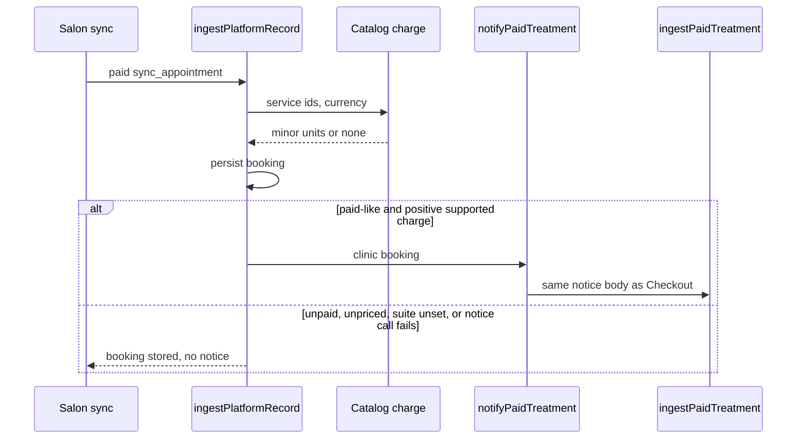
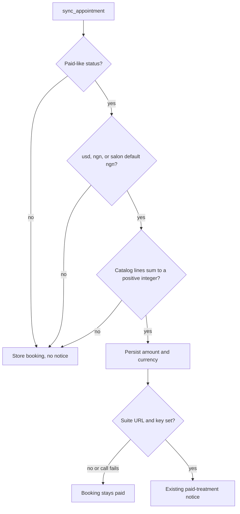

# Salon Paid Treatment Settlement - Plan

**Target repo:** `skintwinnector`

## Goal Capsule

- **Objective:** After SkinTwin Salon syncs a paid appointment whose services exist in the Connect catalog, that charge appears once on the suite orders list, attributed to the performing provider when the roster email is known. A paid salon sync with no catalog-priced lines still stores the booking and does not create an order. A Connect Checkout payment is unchanged.
- **Means:** Platform appointment ingest prices the synced services from the Connect catalog, persists that charge on the clinic booking, and calls the existing paid-treatment notice. (KTD1, KTD3)
- **Authority:** This plan. Product behavior is owned by the R-IDs. Implementation mechanism is owned by the KTD-IDs. Units cite those IDs and do not restate them.
- **Execution profile:** Standard. Payments and the existing Suite notice. Cover pricing, notify, and the silent unpaid/unknown-service paths with Vitest in this repo.
- **Stop conditions:** Stop if a salon-paid `srv-001` sync for Amara Johnson does not notify Suite. Stop if a salon NGN `amountTotal` is stored as `amountMinor` without converting to kobo. Stop if an unpaid or unpriced sync posts. Stop if a later `completed` sync clears a stored paid status. Stop if Checkout `markBookingPayment` behavior changes. Do not call Paystack. Do not change the Stripe application fee. Do not put clinic emails in public JSON. Do not change `/api/platform/sync` authorization.
- **Tail ownership:** One pull request in `skintwinnector`. Suite ingest and the roster stay as they are.

---

## Product Contract

### Summary

A paid salon appointment that reaches Connect through `/api/platform/sync` becomes the same suite order a Connect Checkout payment already creates. The salon booking still saves when Suite is down or the services cannot be priced.

Product Contract preservation: bootstrap, no upstream brainstorm. No person confirmed this phase. The R-IDs are the agent's reading of the next increment after provider-therapist attribution. The bets are under Assumptions.

### Problem Frame

Connect Checkout already notifies Suite after a paid write. Salon already POSTs `sync_appointment` with provider `prv-001`–`prv-004` and catalog service ids. Ingest stores that booking as paid under `cs_platform_<appointment id>` and never sets an amount, so the notice gate fails. The existing test locks that silence in even when the payload carries `amountTotal`. Paid salon treatments never appear on the ledger.

The prior increment deferred this link in `docs/plans/2026-10-01-0253-feat-provider-therapist-attribution-plan.md` and `docs/plans/2026-09-30-1706-feat-paid-treatment-settlement-plan.md`.

### Requirements

**Ledger from salon sync**

- R1. A `sync_appointment` whose status is paid-like, whose service ids price to a positive catalog charge in `usd` or `ngn`, becomes one suite order for `cs_platform_<appointment id>`.
- R2. A later paid sync for the same appointment id returns the existing suite order and does not add another settlement event. Connect may notify again. Suite already dedupes on checkout session.
- R3. The notice amount is minor units for the resolved currency. When the payload has a positive integer `amountTotal`, that value is scaled into minor units and is the charge. When it does not, the Connect catalog total is the charge.
- R4. An unpaid first sync, an unsupported currency, only unknown service ids with no payload amount, or a zero charge creates no suite order. The clinic booking is still stored. A later not-paid-like sync of an already-paid platform booking does not clear `paymentStatus` or the stored charge.

**Attribution and fail-open**

- R5. When the appointment provider id is `prv-001` through `prv-004`, the notice includes that person's server-only clinic email and public name. Suite attribution stays the existing roster match.
- R6. When the provider is missing or not in the catalog, the notice still posts if R1 holds, with an empty provider name and no email. Suite writes a Foundation order.
- R7. If Suite has no base URL, is unreachable, or rejects the notice, the salon booking stays paid.
- R8. A Connect Checkout paid write through `markBookingPayment` still notifies exactly as it does today.

### Actors

- A1. Salon operator — takes payment on the salon rail and syncs the appointment.
- A2. Performing provider — Amara Johnson, Dr. Temi Okonkwo, Chioma Adeyemi, or Ngozi Eze when the provider id is one of the four.
- A3. Suite operator — reads the order ledger.
- A4. Clinic operator on Connect — Checkout path is unchanged.

### Key Flows

- F1. Paid salon treatment
  - **Trigger:** Salon POSTs `sync_appointment` with paid-like status, `prv-001`, and `srv-001`.
  - **Actors:** A1, A2, A3
  - **Steps:** Persist the booking with the catalog charge. Notify Suite with that charge, Amara Johnson's name, and her clinic email.
  - **Covered by:** R1, R3, R5
- F2. Repeat paid sync
  - **Trigger:** The same appointment id is synced paid again.
  - **Actors:** A3
  - **Steps:** The booking key stays `cs_platform_<id>`. Suite returns the stored order.
  - **Covered by:** R2
- F3. Unpriced or unpaid sync
  - **Trigger:** Status is not paid-like, currency is not `usd` or `ngn`, or no catalog service prices.
  - **Actors:** A1
  - **Steps:** The booking is stored. No notice is posted.
  - **Covered by:** R4
- F4. Connect Checkout
  - **Trigger:** Local confirm, webhook, or retrieve marks a Checkout booking paid.
  - **Actors:** A4
  - **Steps:** `markBookingPayment` notifies as it does today.
  - **Covered by:** R8

### Acceptance Examples

- AE1. Covers R1, R3, R5, F1. Given a paid `skintwin-salon` sync for `apt_200`, provider `prv-001`, and service `srv-001` with currency `usd`, Connect posts `checkoutSessionId` `cs_platform_apt_200`, `amountMinor` `8500`, `currency` `usd`, `providerName` `Amara Johnson`, and `providerEmail` `amara.johnson@clinic.skintwin.ai`.
- AE2. Covers R1, R3. Given the same appointment with currency `ngn` or with currency omitted, Connect posts `amountMinor` `850000` and `currency` `ngn` (catalog `price` 8500 NGN as kobo).
- AE3. Covers R3. Given a paid sync that sends `amountTotal` `8500` and currency `ngn`, Connect posts `amountMinor` `850000`, not `8500`. Given `amountTotal` `1` and currency `usd` with `srv-001`, Connect posts `1`, not the catalog `8500`.
- AE4. Covers R4, F3. Given a paid sync with no services and no `amountTotal`, or only `externalId` `srv-missing` and no `amountTotal`, or a first sync with status `draft`, no notice is posted. The booking is stored.
- AE5. Covers R6. Given a paid `srv-001` sync whose provider is `prv-unknown`, the notice posts with `providerName` `""` and no `providerEmail`.
- AE6. Covers R7. Given a missing suite URL or a thrown notice, the stored booking `paymentStatus` is `paid`.
- AE7. Covers R8, F4. Given an existing Checkout `markBookingPayment` paid write for `prv-001`, the notice still posts the Checkout session id and catalog USD amount.

### Scope Boundaries

**In scope**

- Soft catalog pricing for platform appointment selections.
- Persisting that charge on salon ingest and calling the existing notice.
- Updating the clinic-record tests that currently require silence on a paid salon sync with an amount.

**Deferred to Follow-Up Work**

- Teaching `skintwin-salon` `transformAppointment` to always send `totalAmount` and `currency`. Some salon callers already send `totalAmount`; this increment reads it when present.
- Tightening `/api/platform/sync` so `x-skintwin-account` alone cannot authorize a write. That header is pre-existing and out of this increment.
- Replacing the confirmation sentence that still says the appointment is not on the clinic schedule.
- Showing therapist and salon names on Suite Home or in the command palette.
- Rewriting an existing Foundation order onto a therapist after the roster exists.
- Subtracting the Stripe application fee before the split.
- Executing a Paystack transfer.
- Rewriting seed orders onto the policy table.
- Service-catalog UI for add-ons, images, or consultation gates.
- Live Stripe, Paystack, and Shopify credentials.

**Outside this product's identity**

- Replacing the salon Paystack rail.
- Folding Connect, Suite, the LMS, and the salon app into one codebase.
- Settling LMS course orders.

---

## Planning Contract

### Key Technical Decisions

- KTD1. Charge precedence: a positive integer payload `amountTotal` wins. For `ngn` it is NGN major units and `amountMinor` is `amountTotal * 100`. For `usd` it is already cents. When `amountTotal` is absent, the charge is the Connect catalog total only if every non-empty service id prices; a mix of known and unknown ids with no payload amount is no charge. Currency is the payload currency when it is `usd` or `ngn` (case-insensitive, stored lowercase); when the payload omits currency and the source is `skintwin-salon`, currency is `ngn`; any other currency produces no charge. `unitAmountForCurrency` maps catalog USD to `usdChargeCents` and NGN to `price * 100`. Rejected: treating salon NGN `amountTotal` as `amountMinor` without the `* 100`. Checkout still forbids client pricing on the hosted Checkout create path. Governs R1, R3, R4.
- KTD2. Unknown or empty service ids skip rather than throw. Checkout `buildCheckoutLineItems` still throws on unknown ids. A platform sync must store the appointment even when a line cannot be priced. Governs R4.
- KTD3. After `ingestPlatformRecord` persists a `sync_appointment`, it calls `notifyPaidTreatment` on that record. Persist `amountTotal: charge.amountMinor` and the resolved currency only when the status is paid-like and a charge exists. Leave both unset when there is no charge. Never pass a payload `amountTotal` through unchanged. Do not add the notify call to `persistCheckoutBooking`. Rejected: a second Suite client. Governs R1, R7, R8.
- KTD4. Idempotency stays `cs_platform_<appointment id>`. Do not invent a new external ref. Suite already keys orders on checkout session. Governs R2.
- KTD5. Clinic emails stay in `lib/providerRoster.ts`. Do not write them into `app/data/providers.json` or salon `src/data/providers.json`. The latest Connect commit already made that split. Governs R5.
- KTD6. Once a platform booking is stored paid, a later ingest for that `cs_platform_` id does not write a not-paid-like `paymentStatus`. Salon `completed` and similar lifecycle updates may retry the notice. They do not clear the charge. Governs R2, R4, R7.

### High-Level Technical Design

### Assumptions

No person confirmed this phase. The request was the next most relevant SkinTwin platform-services improvement. The bets below are the agent's, and any of them can be rejected.

- The next phase is this salon-sync ledger link. Rejected for this increment: service-catalog UI, Paystack payout, fee netting, live payment keys, rewriting `/api/platform/sync` auth, and a new product surface.
- A platform-authenticated `paid` or `confirmed_paid` status is the payment proof. Connect does not verify a Paystack or Stripe receipt before notifying Suite.
- Payload `amountTotal` is used when present because some salon callers already send the collected total. Catalog pricing is the fallback when they do not. Rejected: waiting to ship until every salon path forwards `totalAmount`.
- A salon source with no currency is NGN. Rejected: defaulting those syncs to USD, which would post 8500 cents instead of 850000 kobo for Signature Facial.
- Checkout is out of the edit set except as a regression. Rejected: routing Checkout through ingest. `/api/platform/sync` authorization stays as it is. Tightening the `x-skintwin-account` header is a later security increment.

### System-Wide Impact

Connect and Suite stay separate processes. The notice body does not gain a field. Salon can keep omitting `totalAmount`; Connect then uses the catalog. When a later transform sends `totalAmount` and `usd` or `ngn`, Connect uses that scaled amount for new notices. `orders.list` is unchanged. `/api/platform/sync` auth is unchanged.

### Risks

- Salon `services.json` and Connect `app/data/services.json` can drift. An id that exists only on salon produces no charge. That is R4, not a silent USD guess.
- NGN kobo amounts are two orders of magnitude larger than the USD demo cents. Suite already accepts `ngn`. Do not reuse the USD 8500 assertion for an NGN salon sync.
- Adding `notifyPaidTreatment` to `persistCheckoutBooking` would also run on unpaid Checkout creates. Keep the call on ingest and on `markBookingPayment` only.
- Soft pricing that skips unknown ids must not be reused by Checkout create, which must keep rejecting unknown ids.
- A later salon transform that sends `currency: 'NGN'` is accepted case-insensitively as `ngn`. Any other currency still produces no charge.

### Sources

- Settlement deferred salon-sync orders until those syncs carry an amount: `docs/plans/2026-09-30-1706-feat-paid-treatment-settlement-plan.md`.
- Attribution deferred the same link: `docs/plans/2026-10-01-0253-feat-provider-therapist-attribution-plan.md`.
- `lib/clinicRecords.ts` `ingestPlatformRecord` persists `sync_appointment` without `amountTotal` or `currency` and does not notify.
- `lib/clinicRecords.test.ts` asserts no post for a paid salon sync with `amountTotal` 8500 and `srv-001`, and also for a paid `srv-001` sync with no amount. Both invert.
- `lib/suiteSettlement.ts` already gates on paid status, positive integer amount, and `usd`/`ngn`, and copies `providerClinicEmail`.
- `lib/bookingCheckout.ts` `unitAmountForCurrency` is the charge map. `buildCheckoutLineItems` throws on unknown ids and must stay that way.
- `skintwin-salon` `src/api/integrations/skintwin-sync.js` `transformAppointment` sends provider and service ids and does not send `totalAmount`. `src/pages/cart.js` already posts `totalAmount: totals.price` on some paid syncs.
- Salon appointment `totalAmount` is NGN major units (`src/api/appointments/create.js`).

---

## Implementation Units

### U1. Soft catalog charge for platform selections

**Goal:** Turn a payload amount or parsed platform service selections, plus a resolved currency, into a minor-unit charge, or into no charge, without throwing.

**Requirements:** R1, R3, R4

**Dependencies:** none

**Files:**

- `lib/platformCharge.ts`
- `lib/platformCharge.test.ts`

**Approach:**

1. Add a pure helper that takes optional payload `amountTotal`, service selections, a currency, a source, and the catalog.
2. Resolve currency per KTD1. Import `unitAmountForCurrency` and `isSupportedChargeCurrency` from `lib/bookingCheckout.ts`. Do not edit that file. Do not call `buildCheckoutLineItems`.
3. When payload `amountTotal` is a positive integer, return `{amountMinor, currency}` using the KTD1 scale. Otherwise return the catalog sum only when every non-empty service id prices. Return no charge for a known-plus-unknown mix with no payload amount, for only-unknown ids, or for an unsupported currency.
4. Keep the currency resolver next to the helper so ingest does not re-state the default.

**Patterns to follow:** `unitAmountForCurrency` and `isSupportedChargeCurrency` in `lib/bookingCheckout.ts`. Do not copy Checkout's throw-on-unknown path.

**Execution note:** Write the failing amount and skip cases first, then the helper.

**Test scenarios:**

- Covers AE1. Selections `[{serviceId: 'srv-001', quantity: 1, addOns: []}]` and `usd` with no payload amount return `amountMinor` 8500.
- Covers AE2. The same selection and `ngn` return `amountMinor` 850000.
- Covers AE3. Payload `amountTotal` 8500 and `ngn` return 850000. Payload `amountTotal` 1 and `usd` with `srv-001` return 1.
- Unknown `srv-missing` plus `srv-001` in `usd` with no payload amount return no charge.
- Only `srv-missing`, empty selections, quantity 0, or currency `zar` return no charge.
- Two `srv-001` at quantity 2 in `usd` return 17000.

**Verification:** The new Vitest file passes. `lib/bookingCheckout.test.ts` still rejects unknown ids on Checkout create.

### U2. Persist the salon charge and notify Suite

**Goal:** A paid priced salon ingest notifies Suite. An unpriced or unpaid first ingest does not. A later completed sync of a paid booking stays paid and may retry the notice. Checkout notify is unchanged.

**Requirements:** R1, R2, R3, R4, R5, R6, R7, R8

**Dependencies:** U1

**Files:**

- `lib/clinicRecords.ts`
- `lib/clinicRecords.test.ts`

**Approach:**

1. When ingesting `sync_appointment`, read currency and `amountTotal` from `appointment` or `data`. Load `app/data/services.json` the same way `app/api/bookings/create_checkout_session/route.ts` does. Resolve the U1 charge.
2. Pass `amountTotal: charge.amountMinor` and the resolved currency into `persistCheckoutBooking` only when the status is paid-like and U1 returned a charge. Leave both unset when there is no charge. Never pass a payload `amountTotal` through unchanged.
3. If an existing booking for that `cs_platform_` id is already paid, do not write a not-paid-like `paymentStatus` per KTD6.
4. After persist, call `notifyPaidTreatment` on that record per KTD3.
5. Invert both current clinic-record silence cases: the paid `srv-001` sync with no amount (AE2) and the paid `srv-001` sync that sends `amountTotal` 8500 (AE1 or AE3).

**Patterns to follow:** `markBookingPayment` already notifies after persist. `lib/clinicRecords.test.ts` already stubs `fetch` and reads `body.json`.

**Test scenarios:**

- Covers AE1. Paid salon sync `apt_200`, `prv-001`, `srv-001`, `currency` `usd`, no payload amount, posts the AE1 body. Client email is absent.
- Covers AE2. The same sync with no currency and no payload amount posts `ngn` and 850000. This replaces the current no-amount silence test.
- Covers AE3. Paid `srv-001` with `amountTotal` 8500 and `ngn` posts 850000. Paid `srv-001` with `amountTotal` 1 and `usd` posts 1.
- Covers AE4. Paid with no services and no amount, paid with only `srv-missing` and no amount, and a first `draft` with `srv-001` do not post. The booking is listed for that operator.
- Covers AE5. Paid `srv-001` with `prv-unknown` posts `providerName` `""` and omits `providerEmail`.
- Covers AE6. Missing suite URL, and a thrown `fetch`, leave `paymentStatus` `paid`. A later `completed` re-sync of that booking stays `paid` and retries the notice.
- Covers AE7. Existing `markBookingPayment` paid cases in this file still post.
- A second paid sync for `apt_200` posts the same `cs_platform_apt_200`.

**Verification:** `yarn test` covers the new ingest cases and the existing Checkout notify cases. Do not add a Suite or salon file to this increment.

---

## Verification Contract

- `skintwinnector` `yarn test` runs Vitest. U1 and U2 are proven there.
- `yarn validate-change` stays green (lint plus `tsc`).
- No new environment variable. No Paystack call. No Stripe application-fee change. No Suite schema change.
- A database-less Connect process still notifies from the in-memory booking store.

---

## Definition of Done

- U1 and U2 meet their verification.
- AE1 through AE7 hold as the automated cases above.
- Both tests that required silence for a paid salon `srv-001` sync (with and without `amountTotal`) are gone or inverted.
- `buildCheckoutLineItems` still throws on unknown service ids.
- Clinic emails are not present in `app/data/providers.json`.
- Abandoned attempt code is not left in the diff.
