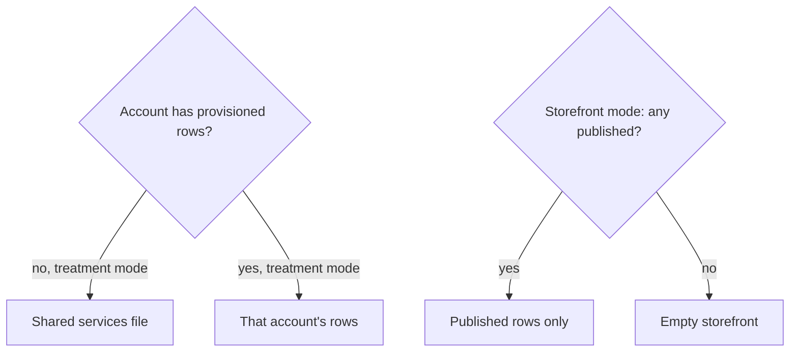
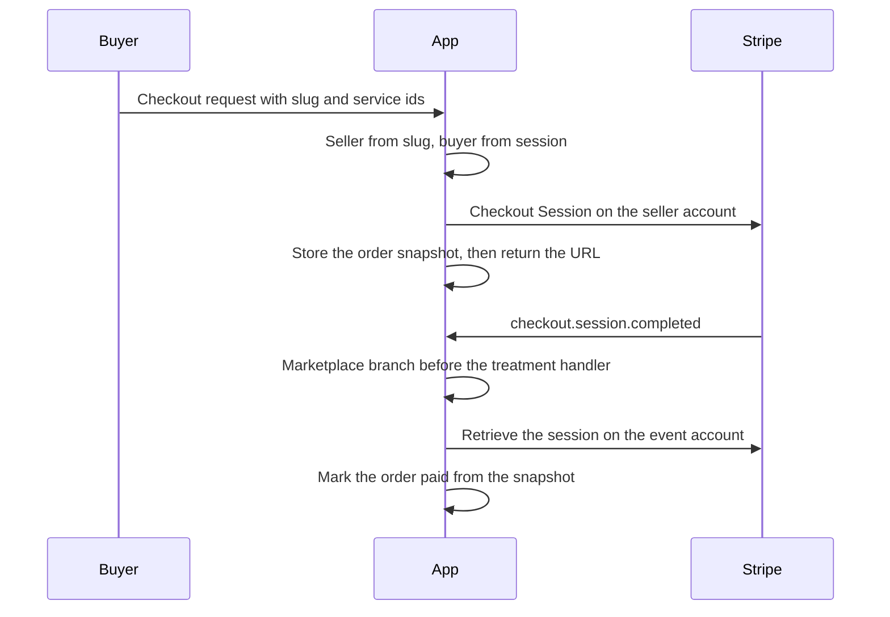

# Salon Storefront Marketplace - Plan

## Goal Capsule

- **Objective:** A salon can sell its own published services to another salon, and that sale stays separate from every other salon's catalog and from clinic treatment bookings.
- **Means:** Per-account catalog rows and a seller-account Checkout Session beside treatment booking (KTD1, KTD2, KTD3).
- **Authority:** Requirements win on product behavior. Key technical decisions win on mechanism. Assumptions are unconfirmed bets; a requirement wins if one conflicts with an assumption.
- **Execution profile:** Code change in this repo. Prove catalog modes in U1 before U4 and U7 wire pages. Prove the seller charge inside U5 and the webhook branch inside U6 before those units return a Checkout URL or a receipt.
- **Stop conditions:** Stop if a marketplace payment updates a treatment booking or notifies Regima Suite. Stop if the charge is created on the buyer account or the platform. Stop if the shared application-fee formula in `lib/bookingCheckout.ts` changes.
- **Finishes and ships:** The implementing agent opens the pull request. A person merges it.

---

## Product Contract

### Summary

Salons provision their own services and publish the ones they sell. Another salon buys those published services from a public storefront. The sale is a separate order from clinic treatment booking.

### Problem Frame

Treatment booking already runs on one shared service list for every salon. A salon cannot put its own services up for sale to other salons. A payment taken for that kind of sale has nowhere to go except the treatment booking path, which records an appointment and notifies Suite.

### Requirements

**Tenancy and provisioning**

- R1. Each salon keeps its own services and sales separate from every other salon.
- R2. A signed-in salon can add, edit, and publish or unpublish its own services.

**Storefront sales**

- R3. Those services are sold through a storefront to other businesses.
- R4. The sale is recorded and completed without creating or changing a clinic treatment booking.

### Actors

- A1. Seller salon. The signed-in salon that provisions services and receives the payment.
- A2. Buyer salon. A different signed-in salon that purchases from the seller's storefront.
- A3. Stripe. Creates the seller's Checkout Session and sends the completion event.

### Key Flows

- F1. Provision and publish
  - **Trigger:** A1 opens the services screen after Stripe onboarding.
  - **Actors:** A1
  - **Steps:** A1 sets a public slug, adds a service, and publishes it.
  - **Outcome:** The service is for sale on A1's storefront and is not listed for any other salon.
  - **Covered by:** R1, R2, R3
- F2. Browse and buy
  - **Trigger:** A2 opens the marketplace index or a storefront link.
  - **Actors:** A2, A1, A3
  - **Steps:** A2 chooses published services and starts checkout. The charge is created on A1's connected account.
  - **Outcome:** A2 receives a Checkout URL for that order.
  - **Covered by:** R1, R3, R4
- F3. Payment completion
  - **Trigger:** A3 reports the Checkout Session completed.
  - **Actors:** A3, A2
  - **Steps:** The app marks the marketplace order paid only when the session is paid and matches the stored snapshot. The treatment booking handler does not run for this event.
  - **Outcome:** A2 can open a receipt. No treatment booking is paid by this event.
  - **Covered by:** R4

### Acceptance Examples

- AE1. Publish a service
  - **Covers:** R2, R3
  - **Given:** A1 is signed in and has set a slug.
  - **When:** A1 adds a service and publishes it.
  - **Then:** A1's storefront lists that service, and A2's storefront does not.
- AE2. Another salon cannot change it
  - **Covers:** R1
  - **Given:** A1 owns a provisioned service.
  - **When:** A2 calls the provision API with that service id.
  - **Then:** The service is unchanged and the response is an authorization failure.
- AE3. A sale is not a treatment
  - **Covers:** R3, R4
  - **Given:** A1 has a published service and A2 is a different salon.
  - **When:** A2 completes payment for that service.
  - **Then:** A2 has a paid marketplace order, and no clinic treatment booking is created or marked paid.

### Scope Boundaries

- Guest checkout, consumer checkout on `skintwin-salon`, and Paystack are out of this product.
- Staff accounts, inventory counts, shipping, tax-formula changes, and multi-seller carts are out of this product.
- Regima Suite remains the treatment-settlement sink. This plan does not add a Suite order for a marketplace sale.
- The platform-sync route's account override stays as it is. New routes do not copy it.

#### Deferred to Follow-Up Work

- Expire unpaid Checkout Sessions on a schedule.
- Include Stripe processing fees in the application fee when the platform is the fee payer.
- Invite more than one user onto a salon.
- Render tests for dashboard pages. This repo's test runner does not mount React.
- Treatment `markBookingPayment` updates an in-memory booking without comparing the account. This plan does not change that path. Marketplace fulfillment must not call it.

#### Outside this product's identity

- The Gatsby salon sample and its Paystack terminal flow.
- Training-lms certification sync.
- Replacing Stripe Connect onboarding or embedded finance pages.

### Sources

- Treatment charge and fee helper: `lib/bookingCheckout.ts`, `app/api/bookings/create_checkout_session/route.ts`.
- Tenant isolation to copy: `lib/clinicRecords.ts`, `app/api/clients/route.ts`, `app/api/webhooks/route.ts`.
- Authorization not to copy: `app/api/platform/sync/route.ts`.
- Local Stripe stand-in returns `id` and `default_currency` only: `lib/localStripeRail.ts`.
- Catalog import sites: `app/components/skintwin/ServiceCatalog.tsx`, `BookingBasket.tsx`, `BookingScheduler.tsx`, `BookingConfirmation.tsx`, `app/components/Schedule.tsx`, and the checkout route above.
- Stripe direct charges: https://docs.stripe.com/connect/direct-charges
- Checkout fulfillment: https://docs.stripe.com/checkout/fulfillment
- Next.js 14 caching: https://nextjs.org/docs/14/app/building-your-application/caching

---

## Planning Contract

### Key Technical Decisions

- KTD1. Catalog and treatment rows stay keyed by `operatorAccountId`, the salon's Stripe Connect account id. A new organization and membership model was the alternative. Clinic rows, checkout metadata, and webhooks already isolate on that id. Governs R1.
- KTD2. A marketplace charge is a direct charge on the seller's connected account. The existing application-fee helper in `lib/bookingCheckout.ts` sets the fee on that new PaymentIntent only. Currency, tax settings, and the Stripe account header come from the seller, not the buyer session. Destination charges, a charge on the buyer account, and any extra fee on a treatment PaymentIntent were rejected. This cart has one seller, and the treatment rail is already a direct charge. Governs R3, R4.
- KTD3. One resolver has two modes. Treatment mode reads `app/data/services.json` only when that account has zero provisioned rows, and otherwise reads only that account's rows, including unpublished ones. The account's first provisioned write copies each shared-file service in as an unpublished row in that same write, then saves the new service. Later writes do not merge the shared file back in. Storefront mode returns published rows for that account and never reads the global file. Prices use `unitAmountForCurrency` for the seller currency. A provisioned row does not fall back to the shared file for a missing id. Governs R2, R3.
- KTD4. Marketplace orders live in their own collection, not `ClinicBooking`. Each order stores `sellerAccountId` and `buyerAccountId`. The seller is the connected account on the Checkout Session and does not change. The webhook retrieves the session on `event.account` and loads the order by that seller account and the retrieved session id. Metadata does not choose the order, the seller, or the buyer. That branch runs before the treatment handler, and only when the row exists. Metadata does not include `draftId`. A checkout event with no marketplace row falls through to the treatment handler. A null or thrown paid-update on an existing marketplace row returns non-2xx. A second event for an already paid row returns 200 and does not write paid again. Paid success compares currency and the stored merchandise total, then stores the collected `amount_total` with tax. A merchandise or currency mismatch is stored and acknowledged without marking the order paid. Suite `ingestPaidTreatment` is not called. Governs R4.
- KTD5. The public storefront is a page outside `app/(dashboard)`, forced dynamic, with no static params. The public id is a unique slug on the salon, not the Connect account id. Governs R3.
- KTD6. The buyer account comes from the session. The seller account comes from the slug lookup. Checkout ignores client prices and client account ids, and it rejects a buyer whose account equals the seller. Live Stripe must show `card_payments` active and `charges_enabled` on the seller. The local stand-in does not return those fields, so that stand-in counts as able to charge. Governs R1, R3.

### Assumptions

These bets were not confirmed in the request. Requirements win if one of them conflicts.

- The work lands in this repository. Suite is not the storefront host.
- The other business in R3 is another signed-in salon, not a guest and not a consumer on the Gatsby app.
- Provisioning means catalog rows on the salon account, not Stripe Product objects.
- A salon with no provisioned rows keeps today's shared treatment list for booking. A storefront with nothing published is empty. KTD3 is the mechanism.
- The marketplace index and the receipt require a login. They do not require finished Stripe onboarding. Publishing stays on the onboarded services screen.
- The salon chooses its slug. The index lists only salons that have a slug and at least one published service.
- A marketplace line is a published service and a quantity. It is not an appointment and it does not schedule treatment add-ons.
- Supporting behavior in this plan is the slug, publish state, the index, the receipt, and tenant isolation.

### High-Level Technical Design

Catalog reads do not share one list.

Purchase and completion stay off the treatment handler.

### System-Wide Impact

- Six modules import `app/data/services.json`. Treatment screens and checkout must use KTD3 or a provisioned salon keeps selling the shared list.
- `app/api/webhooks/route.ts` and `app/api/payments/local/confirm/route.ts` both settle treatment checkout today. A marketplace session has to be recognized from the stored order before either calls `markBookingPayment`. The local confirm route is the completion path CI can run, because placeholder Stripe keys use `lib/localStripeRail.ts` and return `/pay/local/{id}`.
- `app/page.tsx` renders `ServiceCatalog` with no signed-in salon. It keeps the shared list. Dashboard pages do not.
- `app/models/salon.ts` gains the slug field. Email, password, and Stripe account creation stay as they are.
- `app/layout.tsx` wraps every page, including the storefront, in the booking provider. The storefront must not add services into a treatment draft.
- New writes follow the memory-then-Mongo clinic pattern and the operator filter. They do not follow `app/api/platform/sync/route.ts`.

### Risks & Dependencies

- A marketplace session that includes `draftId`, or a success URL of `/bookings/confirmation`, marks a treatment booking on the wrong account. KTD4 forbids both. `app/api/payments/local/confirm/route.ts` currently always calls `markBookingPayment` and always returns that confirmation URL. U6 branches it from the stored order.
- Copying treatment checkout's best-effort save would return a Checkout URL with no order row. The marketplace save returns the row or fails. A null result is a 500 and no URL. A null paid-update is a non-2xx webhook response. KTD4.
- Comparing `amount_total` to the pre-tax snapshot marks every taxed payment as a mismatch and leaves it unpaid. KTD4 compares the merchandise total and stores the collected total.
- Next.js 14 can cache a dynamic segment across salons unless the storefront opts out. KTD5 forces the page dynamic.
- The local account retrieve cannot prove `charges_enabled`. KTD6 treats that stand-in as charge-capable and still checks live accounts. The local rail also ignores `payment_intent_data`, so the fee and seller account are proved on the mocked Checkout create, not on the pay page.
- Clinic lists can prefer a Mongo hit over memory. Marketplace payment status and the published flag do not. A paid memory row is not replaced by an older unpaid Mongo row for the same session. A newer in-memory unpublish is not replaced by an older Mongo published row.
- `findOneAndUpdate` on Mongoose 5 does not run `pre('save')`. Slug and catalog writes that need hooks must `save()` after the model is registered. Do not upgrade Mongoose. `Salon` has no memory store, so slug uniqueness is claimed in the catalog module before it is mirrored onto `Salon`.

### Sequencing

1. U1 resolver and stored rows, with no Stripe call.
2. U2 provision API, GET catalog, and slug.
3. U3 treatment checkout calls the resolver.
4. U7 dashboard and home pass a catalog in.
5. U4 public storefront and index.
6. U5 order and seller Checkout Session.
7. U6 webhook, local confirm, and receipt.

---

## Implementation Units

### U1. Catalog resolver and stored services

- **Goal:** Resolve a salon's services in treatment mode and storefront mode.
- **Requirements:** R1, R2, R3. KTD1, KTD3.
- **Dependencies:** None.
- **Files:** `lib/serviceCatalog.ts`, `lib/serviceCatalog.test.ts`, `app/models/provisionedService.ts`
- **Approach:**
  - Store rows with `operatorAccountId`, service id, the fields already on `app/contexts/booking/types.ts` `Service`, and a published flag.
  - Unique index on account plus service id. Follow the clinic model cache in `app/models/booking.ts`, not the callback validator in `app/models/salon.ts`.
  - Copy the memory-then-Mongo pattern from `lib/clinicRecords.ts`, including a test reset.
  - Treatment mode and storefront mode follow KTD3. Do not merge the global file into a partial salon list.
- **Execution note:** Write the resolver tests first. The two modes are the proof.
- **Patterns to follow:** `lib/clinicRecords.ts`, `app/models/booking.ts`, `lib/clinicRecords.test.ts`
- **Test scenarios:**
  - An account with no rows resolves treatment mode to the shared file ids, and storefront mode to an empty list.
  - An account with one unpublished row resolves treatment mode to that row only, and storefront mode to an empty list.
  - An account with one published row and one unpublished row resolves storefront mode to the published row only.
  - A second account's rows are absent from both modes for the first account.
  - A Mongo failure still returns the in-memory row for that account and not the other account's row.
- **Verification:** `lib/serviceCatalog.test.ts` covers the five cases. No Stripe call is added.

### U2. Provision API and public slug

- **Goal:** Let the signed-in salon write its catalog and choose a slug.
- **Requirements:** R1, R2. KTD1, KTD5, KTD6.
- **Dependencies:** U1
- **Files:** `app/api/services/route.ts`, `app/api/services/route.test.ts`, `app/api/services/[serviceId]/route.ts`, `app/api/services/[serviceId]/route.test.ts`, `app/api/storefront/route.ts`, `app/api/storefront/route.test.ts`, `app/models/salon.ts`, `lib/serviceCatalog.ts`, `lib/serviceCatalog.test.ts`
- **Approach:**
  - `requireOperatorAccount` is the only tenant source. Ignore `operatorAccountId` on the body.
  - GET returns treatment mode for the session account, in the `{error}` style of `app/api/clients/route.ts`.
  - POST creates a row for the session account. The item route updates or publishes only a row owned by that account.
  - A stored row always has an `addOns` array. Omit means an empty array. `durationMinutes` must be a positive integer. `providerTypes` must be a non-empty array of `esthetician` or `specialist`. Missing `usdChargeCents`, `price`, `durationMinutes`, or `providerTypes` is a 400 and stores nothing.
  - The first successful create copies the shared-file services in as unpublished rows for that account, then stores the new service. KTD3.
  - A publish or unpublish whose Mongo mirror fails returns an error and leaves the previous sellable state. A later read must not let an older Mongo published row override a newer in-memory unpublish.
  - Slug claim and release live in `lib/serviceCatalog.ts`, with the same test reset as the catalog. The storefront route calls that claim, then mirrors the slug onto `Salon` with `save()` and a unique sparse index. Omit the field until a slug is claimed. Do not default it to null. A slug already used by another salon is rejected. Do not put the Connect account id in the slug. Do not use `findOneAndUpdate` for the slug. Slug route tests mock `Salon.save` to resolve, because `Salon` has no memory store.
  - Responses use `{error}` and the status style of `app/api/clients/route.ts`.
- **Patterns to follow:** `app/api/clients/route.ts`, `app/api/clients/route.test.ts`, `lib/clinicAuth.ts`
- **Test scenarios:**
  - A session without `stripeAccountId` gets 401 and writes nothing.
  - GET for an account with no rows returns the shared-file ids.
  - GET for an account with one unpublished row returns that row only.
  - POST with a name, `price`, `usdChargeCents`, a positive `durationMinutes`, and `providerTypes: ['esthetician']` stores a row whose account id is the session account, not a body field.
  - That first POST also stores each shared-file service as an unpublished row for the same account.
  - POST without `usdChargeCents` or `providerTypes` returns 400 and stores nothing.
  - PATCH from a second account does not change the first account's row and returns 404.
  - Publishing then unpublishing flips the published flag on the owner's row only.
  - Account `Ada` claims slug `ada`. Account `ada` claiming `Ada` is rejected, and the stored slug remains `ada`.
  - A body that includes `unit_amount` or `operatorAccountId` does not change the stored account or the server price fields taken from the owner's own payload fields `price` and `usdChargeCents`.
- **Verification:** Route tests pass with `dbConnect` mocked to reject and the catalog reset, matching clinic tests.

### U3. Treatment checkout uses the resolver

- **Goal:** Treatment checkout prices the signed-in salon's treatment-mode catalog.
- **Requirements:** R1, R2. KTD3.
- **Dependencies:** U1, U2
- **Files:** `app/api/bookings/create_checkout_session/route.ts`, `app/api/bookings/create_checkout_session/route.test.ts`
- **Approach:**
  - The checkout route loads treatment mode for `session.user.stripeAccountId` instead of importing the JSON module.
  - Seed the provisioned row through the U1 catalog module in tests.
  - Unprovisioned checkout behavior stays on the shared file, per KTD3. Fee, currency, and client-price rejection in the treatment route stay as they are. Screen wiring is U7.
- **Patterns to follow:** `app/api/bookings/create_checkout_session/route.ts`
- **Test scenarios:**
  - An unprovisioned account's checkout line amount still matches the shared file for the same selection the existing test uses.
  - After the first provisioned write, checkout still prices a shared-file id because that id was copied in as an unpublished row. An id that is in neither the shared file nor the new row is rejected.
  - A client body containing `unit_amount` is still rejected.
  - The application fee on that treatment session is unchanged from the existing helper's result for the same total.
- **Verification:** Existing checkout tests still pass for an unprovisioned account. The new provisioned-account case passes. The checkout route does not import the JSON module.

### U7. Treatment catalog on the client pages

- **Goal:** Dashboard booking screens show the signed-in salon's treatment-mode catalog, and the public home keeps the shared list.
- **Requirements:** R1, R2. KTD3.
- **Dependencies:** U1, U2
- **Files:** `app/components/skintwin/ServiceCatalog.tsx`, `app/components/skintwin/BookingBasket.tsx`, `app/components/skintwin/BookingScheduler.tsx`, `app/components/skintwin/BookingConfirmation.tsx`, `app/components/Schedule.tsx`, `app/page.tsx`, `app/(dashboard)/home/page.tsx`, `app/(dashboard)/services/page.tsx`, `app/(dashboard)/bookings/page.tsx`, `app/(dashboard)/bookings/intake/page.tsx`, `app/(dashboard)/bookings/confirmation/page.tsx`
- **Approach:**
  - Those components take a services array from the caller. They do not import `app/data/services.json`.
  - Dashboard pages `fetch` GET `/api/services` and pass the array through, the same way `app/(dashboard)/clients/page.tsx` loads `/api/clients`.
  - `app/page.tsx` has no salon session. It passes the shared file into `ServiceCatalog`.
  - The services screen keeps shared-file treatment rows as booking-only, with the existing add control and no publish control, until a row is stored.
  - Create posts name, price, `usdChargeCents`, duration, and provider types, then refetches the owner's stored rows. Publish and unpublish call the item route only for those stored rows, and they stay disabled until the slug claim succeeds. A rejected slug or a failed save shows the route error. After the slug is stored, the screen links to `/store/{slug}`.
- **Patterns to follow:** `app/(dashboard)/clients/page.tsx`
- **Test scenarios:**
  - The behavior of the list is the U2 GET cases. This unit does not add a React renderer.
  - A caller that passes one unpublished service renders that service's name from the prop, not from a module import. Covered by the component taking the prop, checked by the absence of the JSON import.
- **Verification:** The four skintwin components and `app/components/Schedule.tsx` do not import `app/data/services.json`. `app/page.tsx` may import that file only to pass the shared list. `yarn build` still compiles the dashboard pages.

### U4. Public storefront and marketplace index

- **Goal:** Show published services without the dashboard onboarding gate.
- **Requirements:** R1, R3. KTD3, KTD4, KTD5.
- **Dependencies:** U1, U2
- **Files:** `app/store/[slug]/page.tsx`, `app/(market)/layout.tsx`, `app/(market)/market/page.tsx`, `lib/serviceCatalog.ts`, `lib/serviceCatalog.test.ts`
- **Approach:**
  - The storefront page lives outside `app/(dashboard)` so it does not use `AuthenticatedAndOnboardedRoute`. It exports dynamic rendering and does not generate static params.
  - It resolves the slug to one salon and renders storefront mode through a list component that receives those rows. It does not list clients, bookings, or other salons' services, and it does not call the booking context add-service action. Checkout posting is U5.
  - `listIndexSalons` in `lib/serviceCatalog.ts` returns a salon only when it has a slug and at least one published service. The index requires a session and does not require `details_submitted`.
  - A missing session redirects to `/login` with the requested path as `next`. An empty index states that no published storefront is available yet.
  - The storefront list shows the seller-currency amount: `usdChargeCents / 100` when the seller currency is `usd`, and `price` when it is `ngn`, with that currency code. Checkout still charges minor units through `unitAmountForCurrency`.
- **Patterns to follow:** `app/(dashboard)/layout.tsx` for what not to wrap, `lib/uiPreview.ts` is not the storefront gate
- **Test scenarios:**
  - A known slug with one published service returns that service and not the salon's unpublished row.
  - An unknown slug returns no salon.
  - A salon with rows but zero published services returns an empty list, not the shared file, and is omitted from `listIndexSalons`.
  - `listIndexSalons` includes a salon only when it has both a slug and a published service, and it omits another account's published row.
  - The index loader returns nothing when the session is missing, and it still returns the list when the session has no `details_submitted`.
- **Verification:** The slug and index cases pass in `lib/serviceCatalog.test.ts`. The storefront page module does not import `app/data/services.json` and does not sit under `app/(dashboard)`.

### U5. Marketplace order and seller checkout

- **Goal:** Start a Checkout Session on the seller account and store the order first.
- **Requirements:** R1, R3, R4. KTD2, KTD4, KTD6.
- **Dependencies:** U1, U2, U4
- **Files:** `lib/marketplaceCheckout.ts`, `lib/marketplaceCheckout.test.ts`, `lib/marketplaceOrders.ts`, `lib/marketplaceOrders.test.ts`, `app/models/marketplaceOrder.ts`, `app/api/marketplace/checkout/route.ts`, `app/api/marketplace/checkout/route.test.ts`, `app/store/[slug]/page.tsx`, `app/(auth)/business/form.tsx`
- **Approach:**
  - The route takes slug and service selections. It derives the buyer from the session and the seller from the slug.
  - Prices come from storefront mode through `unitAmountForCurrency` and the existing fee helper, and only after `isSupportedChargeCurrency` accepts the seller currency. An unsupported currency, including `eur`, returns 400 and does not call Stripe. Do not call `buildCheckoutLineItems`. An add-on id does not add a charge line. Quantity is a positive integer up to 100 per line, and the session stays at or under 100 lines.
  - Reject unknown ids, unpublished ids, non-positive quantities, and client fields `unit_amount`, `amount`, `currency`, `price_data`, `operatorAccountId`, and appointment fields.
  - `stripeAccount` is the seller. Currency and tax settings come from that seller account. Do not set `transfer_data` or send a buyer Customer id.
  - Idempotency key starts with `marketplace-checkout:` and is built from the buyer account, the seller account, and the canonical priced lines. A repeat of that key reuses the existing unpaid order and returns its Checkout URL. Do not put a newly minted order id in the key. Do not use the `booking-checkout:` prefix.
  - Session metadata may carry `orderKind` for the local rail. It does not include `draftId`. KTD4 still loads the order by seller account and session id, not by metadata.
  - The stored row includes `sellerAccountId`, `buyerAccountId`, the Checkout Session id, and the merchandise snapshot. The save returns that row or fails. A null or thrown save returns 500 and no `checkoutUrl`.
  - Success and cancel URLs are the receipt route, not `/bookings/confirmation`.
  - The storefront page posts the slug, service id, and quantity through a marketplace start helper. It does not call `loadBookingDraft` or `persistBookingDraft`.
  - With no session, the buy control goes to `/login?next=/store/{slug}` and does not post. With a session and no `stripeAccountId`, it goes to `/business?next=/store/{slug}` and does not post. After that form creates the Connect account, it returns to the storefront path in `next`. When `next` is absent, the business form still continues to `/onboarding`. Purchase does not require `details_submitted`.
  - A returned `checkoutUrl` is assigned to `window.location`. A 400, including a buyer equal to the seller or a seller that cannot charge, shows that error and stays on the storefront.
  - Copy the treatment route's tax flag when the seller's tax settings are active. Do not change the fee helper.
- **Execution note:** Write failing tests for the seller account, the fee, and the rejected buyer before the route exists.
- **Patterns to follow:** `lib/bookingCheckout.ts` helpers `unitAmountForCurrency` and `applicationFeeAmount`, and the route-test shape in `app/api/bookings/create_checkout_session/route.test.ts`. Do not reuse `buildCheckoutLineItems`.
- **Test scenarios:**
  - A buyer session and a seller slug create the session with `stripeAccount` equal to the seller, not the buyer.
  - The fee amount equals the existing helper for that merchandise total, and the create call has no `transfer_data`.
  - Buyer account equal to seller account returns 400 and does not call Stripe.
  - A live seller object with `charges_enabled` false returns 400. A local stand-in object with only `id` and `default_currency` is allowed.
  - A body with `unit_amount` returns 400.
  - A selection whose id is unpublished or owned by a third salon returns 400.
  - Quantity 11 of a published service is charged as 11 times `unitAmountForCurrency`. An `addOns` entry creates no extra line.
  - The idempotency key starts with `marketplace-checkout:` and contains the buyer account and the seller account. A second POST with the same priced lines returns the existing unpaid order's Checkout URL and does not create a second session.
  - A seller `default_currency` of `eur` returns 400 and does not call Stripe.
  - Metadata has no `draftId`.
  - When the order save returns null or throws, the response is 500 and has no `checkoutUrl`.
  - When the save succeeds, the stored row has `sellerAccountId`, `buyerAccountId`, the Checkout Session id, and the merchandise snapshot, with `paymentStatus` unpaid, before the URL is returned.
  - The storefront start helper posts the slug, service id, and quantity, and does not write a booking draft.
- **Verification:** Route tests assert the Stripe arguments and the stored row. Suite fetch is not called.

### U6. Webhook branch and buyer receipt

- **Goal:** Mark the marketplace order paid without touching treatment settlement.
- **Requirements:** R4. KTD4, KTD6.
- **Dependencies:** U5
- **Files:** `app/api/webhooks/route.ts`, `app/api/webhooks/route.test.ts`, `app/api/payments/local/confirm/route.ts`, `app/api/payments/local/confirm/route.test.ts`, `lib/marketplaceOrders.ts`, `lib/marketplaceOrders.test.ts`, `app/(market)/market/orders/[orderId]/page.tsx`, `app/pay/local/[sessionId]/page.tsx`, `app/pay/local/[sessionId]/pay-form.tsx`
- **Approach:**
  - On `checkout.session.completed` and `checkout.session.async_payment_succeeded`, load a marketplace order from `event.account` and the session id on the event before the treatment try/catch. Retrieve the session on `event.account` only after that row exists. Metadata does not select the row. KTD4.
  - A thrown retrieve or a null paid-update on that existing row leaves the webhook response non-2xx. A checkout event with no marketplace row falls through. The treatment path still catches its own retrieve failure and returns 200.
  - Mark paid only while `paymentStatus` is unpaid, and only when currency and the stored merchandise total match. Store the collected `amount_total`. Do not reprice from the catalog. Do not insert a second row. Do not change `sellerAccountId` or `buyerAccountId`.
  - An already paid row returns 200 without writing paid again.
  - This branch does not call `markBookingPayment` or `notifyPaidTreatment`.
  - `app/api/payments/local/confirm/route.ts` uses the same order lookup. A marketplace hit marks the order paid only when the signed-in salon matches `buyerAccountId` and the local session currency and merchandise total match the snapshot. Otherwise it returns 403 or 400 and does not write paid. It returns the receipt URL and does not call `markBookingPayment`. Live Stripe keys still return the route's current 409. A treatment session with `draftId` still returns `/bookings/confirmation` and still marks the booking.
  - The local pay page and `pay-form.tsx` follow the URL returned by that route. They do not force `/bookings/confirmation` when the route returns the receipt.
  - The receipt loads the order only for the session buyer and retrieves the session on the seller account. It does not write `paymentStatus`. It shows the session payment status and the order payment status as separate facts, including a stored mismatch. While the session is paid, the order is unpaid, and no mismatch is stored, the page reloads the order. A session that is not paid links back to that seller's storefront. A missing order says the receipt is unavailable.
- **Execution note:** Write the webhook tests first. One marketplace event and one treatment event are the pair that must not regress.
- **Patterns to follow:** `app/api/webhooks/route.ts`, `app/api/webhooks/route.test.ts`
- **Test scenarios:**
  - A marketplace event with `payment_status` paid updates the existing unpaid row and does not call `markBookingPayment`.
  - The same session delivered again stays one paid row and does not write paid a second time.
  - A marketplace event with no `draftId` still does not call `markBookingPayment`.
  - A treatment event whose metadata has `draftId` and a matching `operatorAccountId` still calls `markBookingPayment`.
  - A treatment event whose retrieve throws still returns 200.
  - `payment_status` unpaid does not mark the order paid.
  - Retrieved merchandise total that differs from the snapshot does not mark the order paid, and the response is still success.
  - A paid session whose `amount_total` is the merchandise total plus tax marks the order paid and stores the collected total.
  - A thrown or null order write on a paid marketplace event makes the webhook response non-2xx.
  - An event whose `account` differs from the stored seller does not change the row.
  - A local confirm for a session that has a marketplace order returns the receipt URL and marks that order paid only for the signed-in buyer when the snapshot matches. It does not call `markBookingPayment` or Suite.
  - A local confirm from a different salon returns 403 and does not mark the order paid.
  - A local confirm for a treatment session with `draftId` and `operatorAccountId` still returns 200 and a `/bookings/confirmation` URL containing that session id.
  - A failed marketplace order write on local confirm returns non-2xx and no URL.
  - The receipt loader returns the order to the buyer session and does not call `markBookingPayment` when it retrieves the session on the seller account.
  - A different salon loading that order id gets no order.
- **Verification:** Webhook tests cover the marketplace event and the existing treatment event. Local confirm tests cover both the marketplace order and the treatment session. The receipt loader test uses the seller account id from the order, not the buyer session, as the Stripe account option.

---

## Verification Contract

| Check                | Command                | Applies to       |
| -------------------- | ---------------------- | ---------------- |
| Unit and route tests | `yarn test`            | U1–U7            |
| Lint and types       | `yarn validate-change` | U1–U7            |
| Production build     | `yarn build`           | U4, U6, U7 pages |

CI on pull requests to `master` runs those three in `.github/workflows/test.yml` on Node 22. Catalog and clinic tests keep mocking `dbConnect` to reject. Slug route tests mock `Salon.save` because that model has no memory store. No new environment variable is required.

---

## Definition of Done

- R1–R4 hold for two salon accounts in the tests named on U1, U2, U5, and U6.
- Treatment checkout for an unprovisioned salon still prices the shared file and still notifies Suite only through the existing paid-treatment path.
- A marketplace payment does not call `markBookingPayment` or Suite, including on `app/api/payments/local/confirm/route.ts`.
- A local treatment confirm with `draftId` still returns `/bookings/confirmation`.
- The skintwin catalog components and `app/components/Schedule.tsx` no longer import `app/data/services.json`. The checkout route does not import it either.
- Abandoned experiments and unused routes are not left in the diff.
- `yarn test`, `yarn validate-change`, and `yarn build` succeed.
